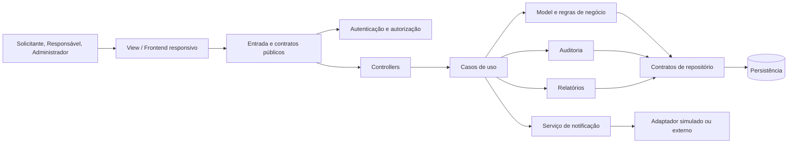

# Arquitetura do sistema

## Status e escopo

Esta documentação define a arquitetura lógica proposta para o sistema de alocação de salas, professores e materiais. Está baseada em `personas.md`, `requisitos-funcionais.md` e `requisitos-nao-funcionais.md`.

A arquitetura segue MVC e mantém o domínio, contratos, banco de dados, provedores e infraestrutura desacoplados de tecnologia. A seleção de stack para a espinha dorsal está registrada no [ADR-009](adrs/ADR-009-java-spring-react.md): Java Spring Boot no backend e React para web. A seleção não determina banco de dados nem infraestrutura de produção.

## Objetivos arquiteturais

- Atender os fluxos dos perfis Solicitante, Responsável e Administrador.
- Evitar sobreposição e dupla reserva, inclusive sob solicitações simultâneas.
- Preservar a consistência de reservas, aprovações, movimentações e auditoria.
- Suportar frontend responsivo e contratos públicos documentados.
- Atender a meta de teste controlado com 2.000 usuários simultâneos especificada nos RNFs.
- Permitir evolução e substituição de tecnologias sem acoplar o domínio a fornecedores.

## Stack selecionada para a espinha dorsal

- **Backend:** Java 21 e Spring Boot 3.5.7.
- **Frontend:** React 19 e Vite 6.
- **Testes:** JUnit/Spring Boot Test no backend; Vitest e Testing Library no frontend.
- **Persistência hospedada selecionada:** PostgreSQL gerenciado no Neon, configurado pelo perfil `prod` e variáveis externas; o banco local `dev` usa H2 em memória e descartável.
- **Migrações:** Flyway versiona o schema PostgreSQL; o Hibernate valida o schema no perfil `prod`, sem alterá-lo automaticamente.
- **Banco de integração pretendido:** PostgreSQL 16 em Testcontainers verifica migrações e schema; no CI do candidato, o teste foi ignorado porque o runner não encontrou um ambiente Docker válido.

As seleções estão registradas em ADR-009, ADR-010 e ADR-011. O estado atual inclui fluxos de autenticação, autorização, gestão de recursos e reservas, auditoria, movimentações e relatórios; cobertura e lacunas de validação estão registradas na RTM e no relatório de qualidade.

O teste PostgreSQL/Testcontainers não foi comprovado na execução de CI atual; resultados H2 não substituem a validação do banco PostgreSQL.

## Estilo e organização

A aplicação adota MVC com separação lógica de apresentação, entrada, casos de uso, domínio e persistência. Os componentes se comunicam por contratos definidos; adaptadores isolam integrações e mecanismos de armazenamento.

O diagrama de componentes completo está em [`modelagens-estaticas/diagrama-componentes.md`](modelagens-estaticas/diagrama-componentes.md). O modelo de entidades está em [`modelagens-estaticas/diagrama-classes-entidades.md`](modelagens-estaticas/diagrama-classes-entidades.md), e os fluxos estão em [`modelagens-dinamicas/sequencias-requisitos-funcionais.md`](modelagens-dinamicas/sequencias-requisitos-funcionais.md).

As jornadas ponta a ponta de Solicitante, Responsável e Administrador estão em [`modelagens-dinamicas/fluxos-por-jornada.md`](modelagens-dinamicas/fluxos-por-jornada.md).

## Responsabilidades

| Componente | Responsabilidade |
| --- | --- |
| View / frontend | Apresentar pesquisa, disponibilidade, cadastros, reservas, aprovações, movimentações e relatórios; adaptar a interface a diferentes larguras e apresentar estados e erros compreensíveis. |
| Entrada e contratos públicos | Receber operações, validar estrutura, aplicar limites de entrada e expor contratos documentados. |
| Autenticação e autorização | Identificar o usuário e verificar no servidor o perfil, a permissão e o escopo do recurso solicitado. |
| Controllers | Traduzir solicitações da interface para casos de uso e resultados para respostas; não são a fonte das regras de domínio. |
| Casos de uso | Coordenar fluxos e suas transações, delegando validações e persistência aos componentes adequados. |
| Model e domínio | Aplicar regras de horário, disponibilidade, quantidade, aprovação, manutenção e estado das reservas. |
| Repositórios | Isolar consultas e gravações do mecanismo de persistência e oferecer operações transacionais. |
| Auditoria | Registrar ações relevantes com usuário, entidade afetada, ação e data/hora, protegendo a integridade histórica. |
| Notificação | Enviar por simulador ou adaptador externo e registrar falhas sem desfazer operações de negócio válidas. |
| Relatórios | Calcular utilização por recurso, carga horária alocada e conflitos evitados a partir de dados rastreáveis. |

## Táticas arquiteturais

As táticas abaixo são decisões propostas e cada uma possui um ADR em [`adrs/`](adrs/README.md).

| Tática | ADR | RFs relacionados | RNFs principais |
| --- | --- | --- | --- |
| Separação MVC, domínio independente e adaptadores | [ADR-001](adrs/ADR-001-mvc-e-separacao-de-responsabilidades.md) | RF-01 a RF-14 | RNF-19, RNF-21, RNF-22 |
| Autorização no servidor por perfil e escopo | [ADR-002](adrs/ADR-002-autorizacao-no-servidor.md) | RF-01 a RF-12 | RNF-15, RNF-18 |
| Validação no frontend e servidor, com erros seguros | [ADR-003](adrs/ADR-003-validacao-e-erros-do-frontend.md) | RF-01 a RF-14 | RNF-02, RNF-08, RNF-09, RNF-10, RNF-16, RNF-18 |
| Transação e controle de concorrência na reserva | [ADR-004](adrs/ADR-004-reserva-atomica-e-concorrencia.md) | RF-04, RF-05, RF-06, RF-08, RF-09 | RNF-03, RNF-04, RNF-11, RNF-20 |
| Auditoria persistida com operação de negócio | [ADR-005](adrs/ADR-005-auditoria-consistente.md) | RF-02, RF-04, RF-07, RF-08, RF-09, RF-10 | RNF-13, RNF-18 |
| Notificação desacoplada e tolerante a falha | [ADR-006](adrs/ADR-006-notificacao-desacoplada.md) | RF-04, RF-07, RF-11 | RNF-07, RNF-12 |
| Consultas filtradas e registro de conflitos | [ADR-007](adrs/ADR-007-consultas-e-relatorios.md) | RF-03, RF-05, RF-12 | RNF-03, RNF-05 |
| Configuração por ambiente e contratos agnósticos | [ADR-008](adrs/ADR-008-portabilidade-e-adaptadores.md) | RF-11, RF-14 | RNF-06, RNF-07, RNF-21, RNF-22 |
| Seleção de Java Spring Boot e React | [ADR-009](adrs/ADR-009-java-spring-react.md) | RF-01 a RF-14 | RNF-03, RNF-06, RNF-08, RNF-19, RNF-21, RNF-22 |

## Qualidades e validação arquitetural

- **Adequação funcional:** validar cada caso de uso contra os RFs numerados e verificar estado persistido e resposta apresentada.
- **Desempenho:** executar o perfil controlado de 2.000 usuários simultâneos; reportar p50/p95/p99, erros, timeouts e tempos medidos na interface.
- **Compatibilidade e usabilidade:** executar fluxos nos navegadores definidos e nos viewports de 360 px, 768 px e 1280 px.
- **Confiabilidade:** injetar falhas nos fluxos transacionais e de notificação; confirmar ausência de registros parciais e de estado falso de sucesso.
- **Segurança:** validar permissões por perfil, escopo de reservas, proteção de credenciais, validação no servidor e ausência de detalhes internos nas respostas.
- **Manutenibilidade e portabilidade:** revisar limites entre camadas e executar os mesmos fluxos em ambientes configurados sem alteração do código.

Os critérios mensuráveis completos estão em `requisitos-nao-funcionais.md`. A arquitetura não afirma que esses critérios já foram testados ou atingidos.

## Catálogo de ADRs

O índice, status e rastreabilidade das decisões estão em [`adrs/README.md`](adrs/README.md). ADR-009 registra a stack escolhida para a espinha dorsal; os demais ADRs permanecem **Propostos** e devem ser confirmados ou revisados antes de implementar cada tática.
