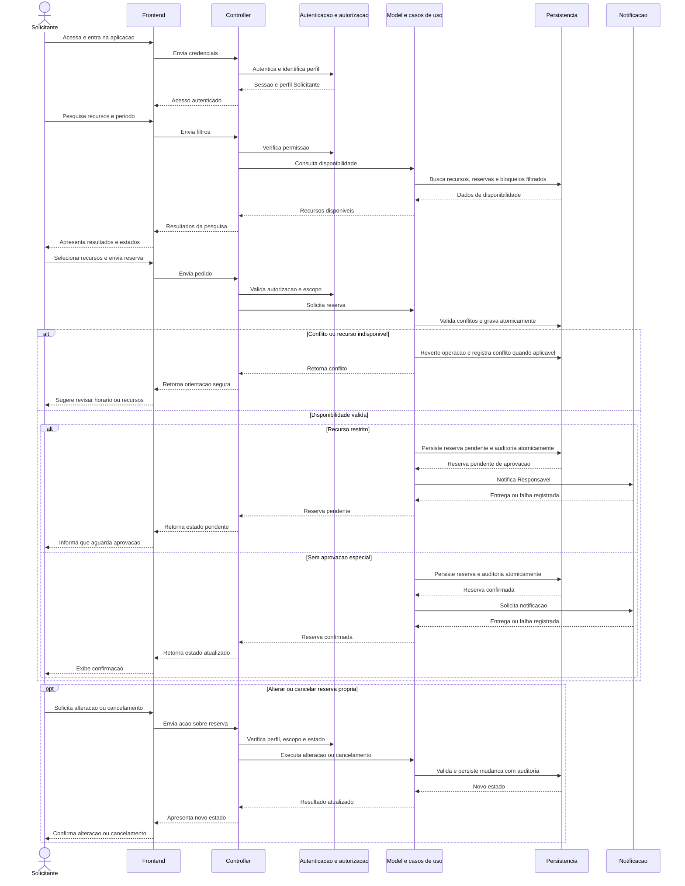
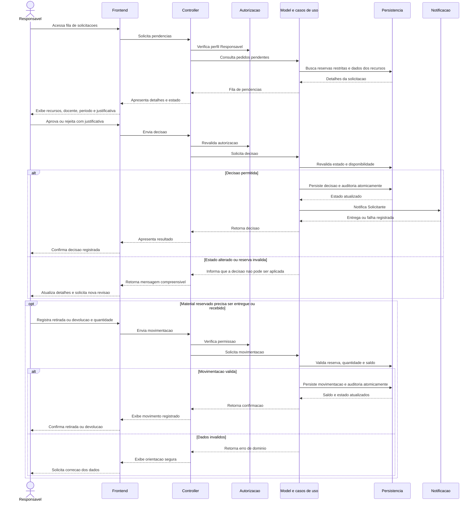
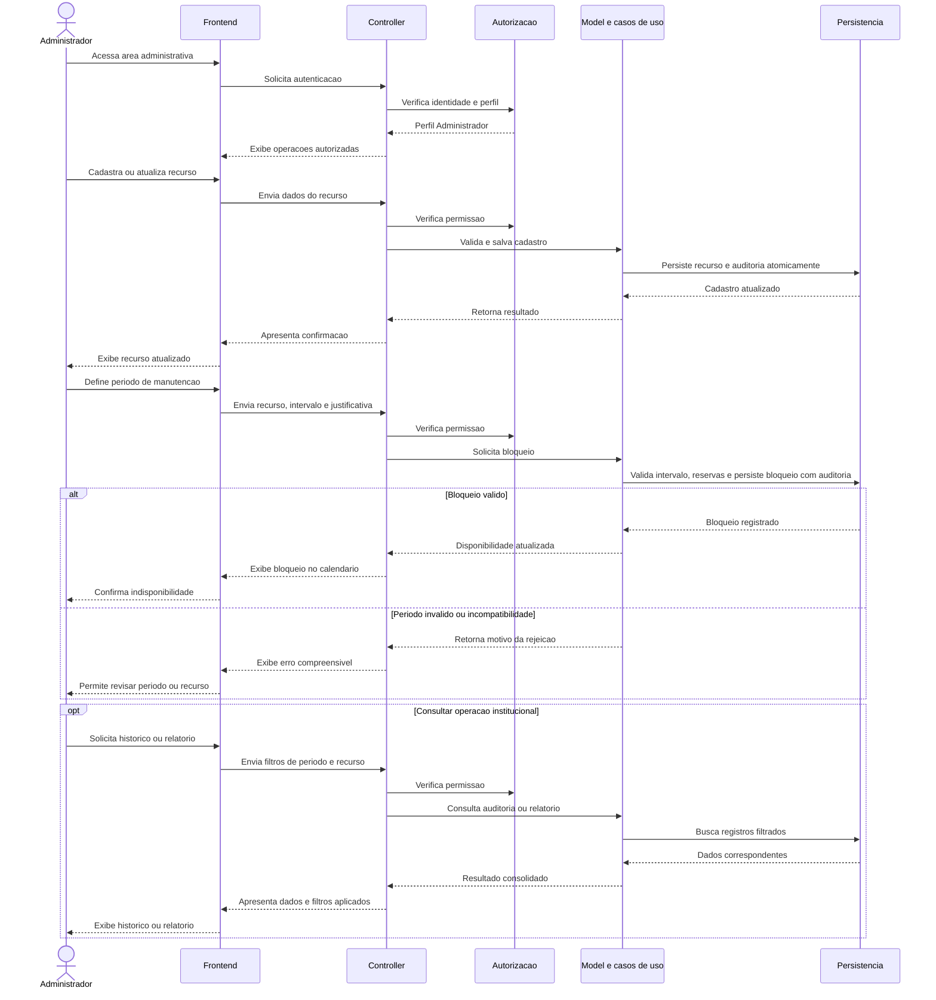

# Fluxos por jornada — diagramas UML de sequência

Os diagramas representam jornadas sugeridas para as três personas, da interação no frontend até a validação e persistência lógica. São modelos documentais agnósticos a tecnologia. Os diagramas de sequência por requisito funcional estão em [`sequencias-requisitos-funcionais.md`](sequencias-requisitos-funcionais.md).

## Jornada do Solicitante — pesquisar e acompanhar reserva

**RFs:** RF-01, RF-03, RF-04, RF-05, RF-06, RF-07, RF-11 e RF-13. **RNFs:** RNF-02, RNF-03, RNF-04, RNF-07, RNF-08, RNF-09, RNF-10, RNF-11 e RNF-15.

## Jornada do Responsável — decidir solicitação e acompanhar material

**RFs:** RF-01, RF-03, RF-04, RF-07, RF-09, RF-10, RF-11 e RF-13. **RNFs:** RNF-02, RNF-07, RNF-08, RNF-09, RNF-11, RNF-13 e RNF-15.

## Jornada do Administrador — manter cadastros e disponibilidade

**RFs:** RF-01, RF-02, RF-03, RF-08, RF-10, RF-12 e RF-13. **RNFs:** RNF-02, RNF-03, RNF-05, RNF-08, RNF-09, RNF-13, RNF-15 e RNF-16.

## Relação com os diagramas por RF

Estes diagramas descrevem jornadas ponta a ponta centradas nas personas. Para detalhes isolados de cada RF e sua relação com RNFs, consultar [`sequencias-requisitos-funcionais.md`](sequencias-requisitos-funcionais.md).
