# Modelagens dinâmicas — sequências dos requisitos funcionais

Cada RF possui um diagrama de sequência próprio. Os requisitos não funcionais relacionados estão indicados junto a cada fluxo; os códigos e textos completos estão em `../requisitos-nao-funcionais.md`. Os diagramas descrevem o fluxo lógico; a implementação correspondente usa React/Vite, Spring Boot, JWT, Spring Data JPA e H2/PostgreSQL. Os principais endpoints e classes estão em `../rtm.md`. Os diagramas não implicam que todos os fluxos já tenham teste de aceitação executável.

## RF-01 — Autenticação e autorização por perfil

**RNFs relacionados:** RNF-01, RNF-03, RNF-06, RNF-09, RNF-14, RNF-15, RNF-17 e RNF-18. **Personas:** SOL, RES, ADM.

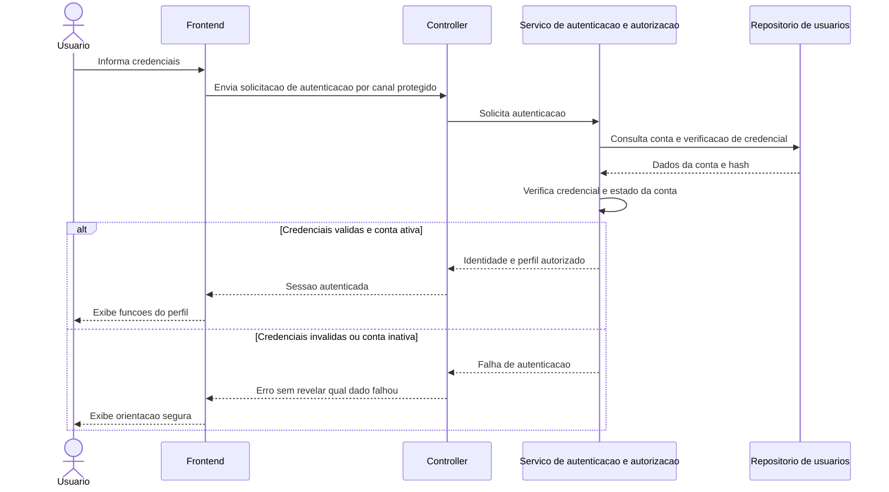

## RF-02 — Cadastro e consulta de salas, professores e materiais

**RNFs relacionados:** RNF-01, RNF-03, RNF-06, RNF-08, RNF-15, RNF-16, RNF-19 e RNF-20. **Personas:** ADM para cadastro; SOL, RES e ADM para consulta conforme permissão.

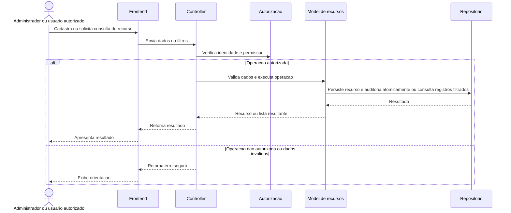

## RF-03 — Pesquisa por tipo, capacidade, localização, competência e disponibilidade

**RNFs relacionados:** RNF-01, RNF-03, RNF-05, RNF-06, RNF-08, RNF-16 e RNF-20. **Personas:** SOL, RES, ADM.

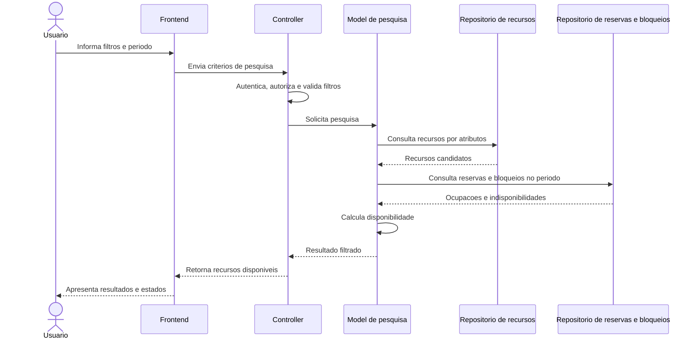

## RF-04 — Criação, alteração e cancelamento de reservas

**RNFs relacionados:** RNF-01 a RNF-04, RNF-07 a RNF-13, RNF-15, RNF-16, RNF-19 e RNF-20. **Personas:** SOL, RES e ADM de acordo com autorização.

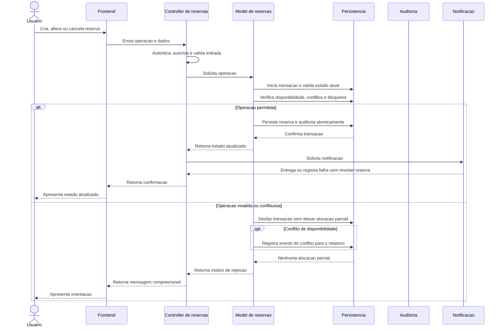

## RF-05 — Detecção de sobreposição, inclusive na agenda do professor

**RNFs relacionados:** RNF-01, RNF-03, RNF-04, RNF-11, RNF-16 e RNF-20. **Personas:** SOL, RES e ADM.

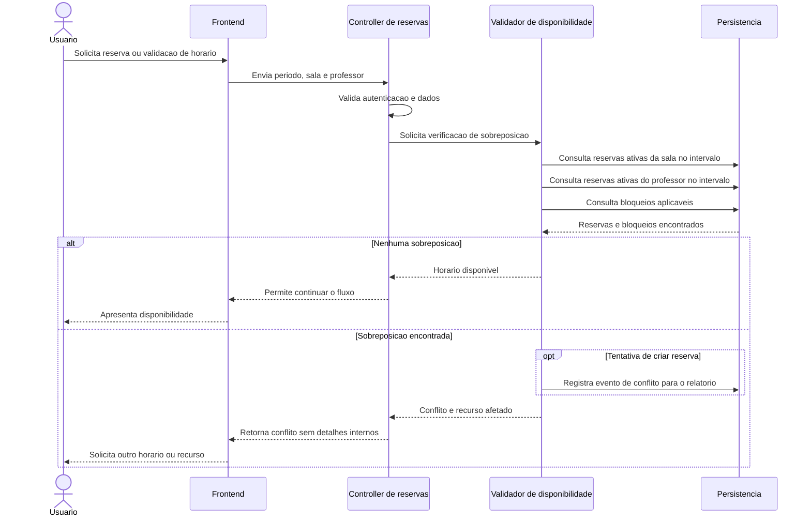

## RF-06 — Proteção contra dupla reserva em solicitações simultâneas

**RNFs relacionados:** RNF-01, RNF-03, RNF-04, RNF-11 e RNF-20. **Personas:** SOL, RES e ADM.

```mermaid
sequenceDiagram
    actor U1 as Solicitante A
    actor U2 as Solicitante B
    participant C1 as Controller A
    participant C2 as Controller B
    participant M as Servico de reserva
    participant DB as Persistencia transacional
    U1->>C1: Solicita mesmo recurso e horario
    U2->>C2: Solicita mesmo recurso e horario
    C1->>M: Criar reserva A
    C2->>M: Criar reserva B
    par Solicitacao A
        M->>DB: Tenta proteger recurso e validar A
    and Solicitacao B
        M->>DB: Tenta proteger recurso e validar B
    end
    DB-->>M: Serializa as tentativas conflitantes
    alt Solicitacao A confirma primeiro
        M->>DB: Confirma reserva A
        DB-->>M: A persistida
        M->>DB: Registra evento de conflito da tentativa B
        M-->>C1: Reserva confirmada
        M-->>C2: Conflito; nenhuma alocacao B persistida
    else Solicitacao B confirma primeiro
        M->>DB: Confirma reserva B
        DB-->>M: B persistida
        M->>DB: Registra evento de conflito da tentativa A
        M-->>C2: Reserva confirmada
        M-->>C1: Conflito; nenhuma alocacao A persistida
    else Falha antes de confirmar uma alocacao
        DB-->>M: Transacao revertida
        M-->>C1: Erro sem alocacao parcial
        M-->>C2: Erro sem alocacao parcial
    end
```

## RF-07 — Aprovação obrigatória para recursos restritos

**RNFs relacionados:** RNF-01, RNF-02, RNF-03, RNF-07, RNF-10, RNF-13, RNF-15, RNF-16 e RNF-20. **Personas:** SOL e RES; ADM conforme permissão.

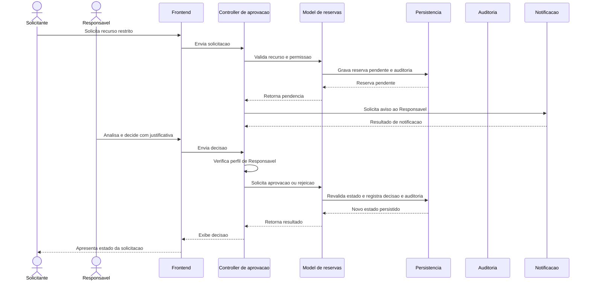

## RF-08 — Bloqueio de recursos em manutenção

**RNFs relacionados:** RNF-01, RNF-02, RNF-03, RNF-10, RNF-11, RNF-13, RNF-15, RNF-16 e RNF-20. **Personas:** ADM cadastra; SOL e RES recebem disponibilidade atualizada.

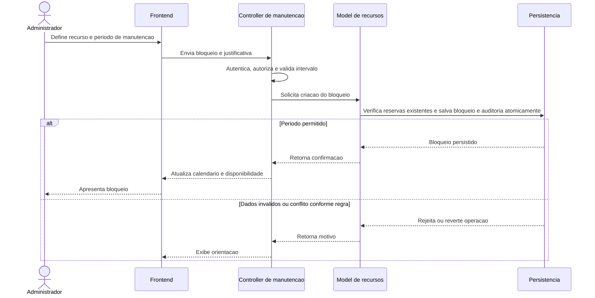

## RF-09 — Registro de retirada e devolução de materiais e equipamentos

**RNFs relacionados:** RNF-01, RNF-02, RNF-03, RNF-08, RNF-11, RNF-13, RNF-15, RNF-16 e RNF-20. **Personas:** RES registra; SOL e ADM consultam conforme autorização.

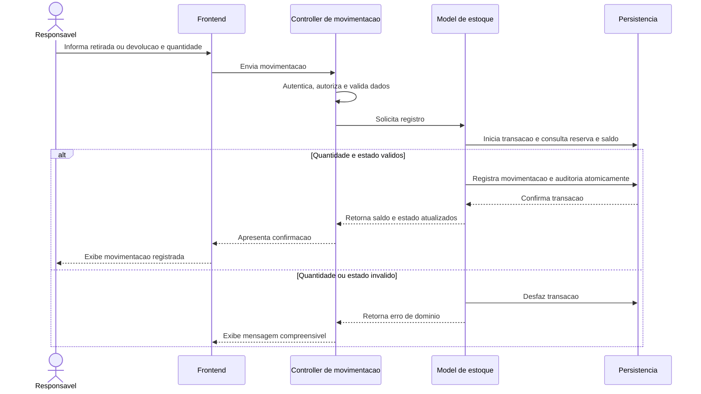

## RF-10 — Histórico auditável de mudanças

**RNFs relacionados:** RNF-01, RNF-02, RNF-13, RNF-15, RNF-18 e RNF-20. **Personas:** RES e ADM consultam; SOL consulta dados permitidos.

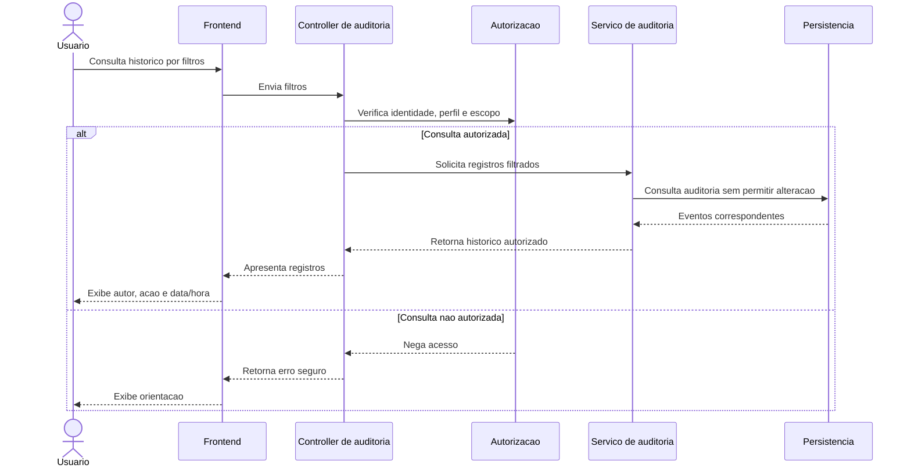

## RF-11 — Notificação simulada ou integração com API externa

**RNFs relacionados:** RNF-01, RNF-02, RNF-03, RNF-07, RNF-12, RNF-16 e RNF-18. **Personas:** SOL, RES e ADM, conforme evento e destinatário.

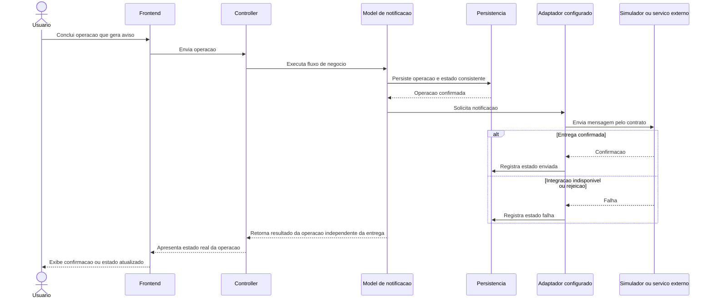

## RF-12 — Relatório de utilização, carga horária e conflitos evitados

**RNFs relacionados:** RNF-01, RNF-02, RNF-03, RNF-05, RNF-15 e RNF-16. **Personas:** RES e ADM.

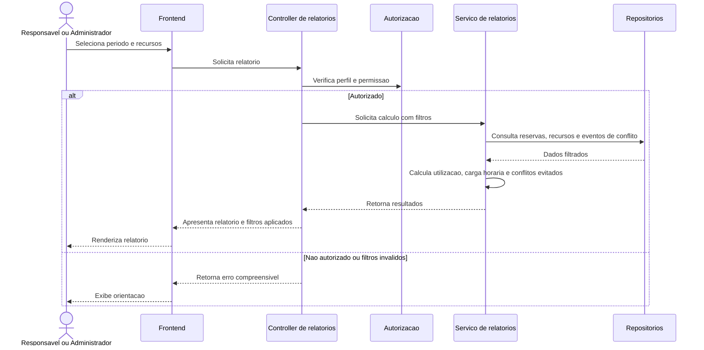

## RF-13 — Interface responsiva e mensagens de erro compreensíveis

**RNFs relacionados:** RNF-01, RNF-02, RNF-06, RNF-08, RNF-09, RNF-10 e RNF-18. **Personas:** SOL, RES e ADM.

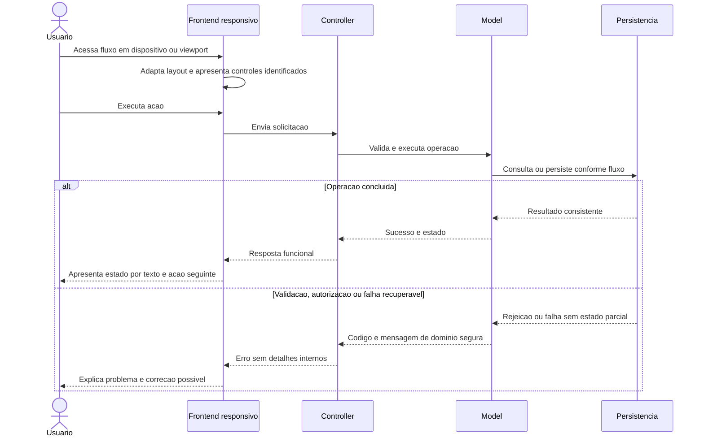

## RF-14 — Documentação de API ou dos fluxos públicos do sistema

**RNFs relacionados:** RNF-01, RNF-17, RNF-18, RNF-19, RNF-21 e RNF-22. **Personas:** consumidores dos fluxos públicos e equipe responsável pela documentação; não corresponde a uma ação operacional das três personas de uso.

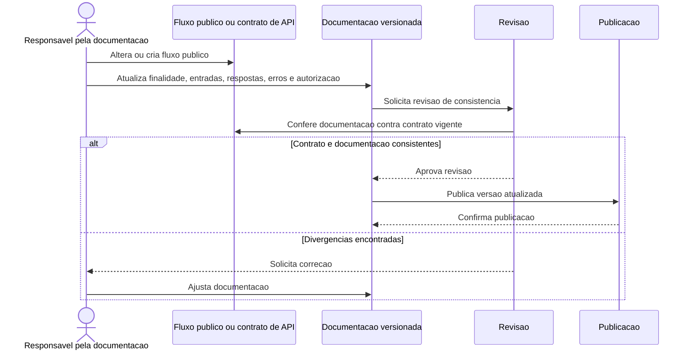

## Cobertura dos requisitos

| RF | Fluxo modelado | RNFs principais |
| --- | --- | --- |
| RF-01 | Autenticação e autorização por perfil | RNF-14, RNF-15, RNF-17 |
| RF-02 | Cadastro e consulta de recursos | RNF-15, RNF-16, RNF-19 |
| RF-03 | Pesquisa filtrada e disponibilidade | RNF-03, RNF-05, RNF-16 |
| RF-04 | Criar, alterar e cancelar reserva | RNF-03, RNF-04, RNF-11, RNF-13 |
| RF-05 | Detecção de sobreposição | RNF-04, RNF-11, RNF-20 |
| RF-06 | Proteção contra dupla reserva | RNF-03, RNF-04, RNF-11 |
| RF-07 | Aprovação de recurso restrito | RNF-07, RNF-13, RNF-15 |
| RF-08 | Bloqueio por manutenção | RNF-11, RNF-13, RNF-20 |
| RF-09 | Retirada e devolução | RNF-11, RNF-13, RNF-20 |
| RF-10 | Consulta de auditoria | RNF-13, RNF-15, RNF-18 |
| RF-11 | Envio ou simulação de notificação | RNF-07, RNF-12, RNF-18 |
| RF-12 | Relatórios | RNF-03, RNF-05, RNF-15 |
| RF-13 | Uso responsivo e mensagens | RNF-06, RNF-08, RNF-09, RNF-10 |
| RF-14 | Ciclo de documentação dos fluxos públicos | RNF-19, RNF-21, RNF-22 |
