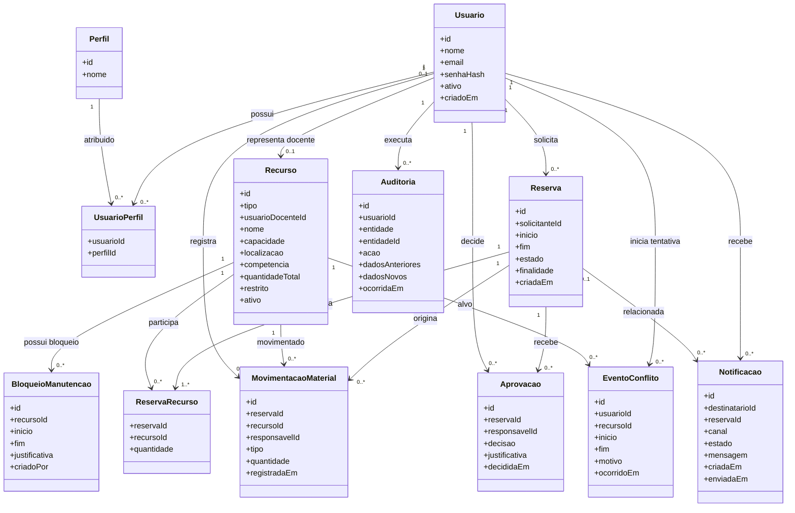

# Diagrama estático de classes e entidades

## Escopo

Modelo lógico das entidades e associações persistentes. Ele delimita os conceitos do domínio sem definir tipos físicos, sintaxe ou fabricante de banco de dados. A classe `Recurso` representa sala, professor ou material/equipamento; seus atributos opcionais são aplicáveis conforme o tipo.

## Definições e regras do modelo

- **Usuario / Perfil / UsuarioPerfil:** identidade, autenticação e associação aos perfis Solicitante, Responsável e Administrador. Senhas são representadas apenas por hash.
- **Recurso:** sala, professor ou material/equipamento. Capacidade, localização, competência e quantidade aplicam-se conforme o tipo.
- **Reserva / ReservaRecurso:** solicitação com período e associação aos recursos; a quantidade atende a recursos inventariáveis.
- **Aprovacao:** decisão do Responsável sobre reserva que exige aprovação, incluindo autoria, justificativa e momento.
- **BloqueioManutencao:** indisponibilidade temporal de um recurso.
- **MovimentacaoMaterial:** retirada ou devolução de material/equipamento por quantidade e responsável.
- **Auditoria:** registro append-only das ações relevantes, associado ao usuário e à entidade afetada.
- **EventoConflito:** tentativa rejeitada por conflito, usada para calcular conflitos evitados no relatório RF-12.
- **Notificacao:** registro de notificação simulada ou integrada, incluindo estado de falha.

Intervalos de reserva e bloqueio têm início anterior ao fim. Para salas e professores não pode haver reserva sobreposta. Para materiais/equipamentos, a soma de quantidades alocadas no intervalo não pode superar o estoque disponível. A validação e a gravação devem ser protegidas contra concorrência.
