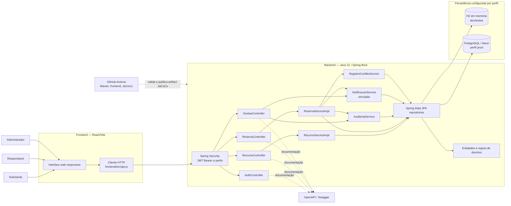

# Diagrama estático de componentes

## Escopo

O diagrama representa a implementação TaskFlow deste candidato local. A arquitetura documentada ainda precisa ser confirmada no commit integrado à `main`.

## Responsabilidades e limites

- **Interface React:** apresenta os fluxos e erros retornados pela API; não substitui autenticação, autorização ou validação no servidor.
- **Spring Security e JWT:** valida token e perfil nas operações protegidas.
- **Controllers:** adaptam contratos HTTP e encaminham operações aos serviços.
- **Serviços de aplicação:** coordenam regras de recursos, reservas, auditoria, notificação simulada e registro de conflitos.
- **Spring Data JPA e entidades:** realizam persistência e representam recursos, reservas, usuários e eventos relacionados.
- **Persistência:** H2 é usada no perfil local; PostgreSQL/Neon é selecionado por configuração no perfil `prod`. Nenhuma conta inicial é criada no Neon.
- **OpenAPI/Swagger:** publica contratos; não participa da execução dos fluxos.
- **GitHub Actions:** executa validações automatizadas e, após sucesso do Maven, publica `jacoco-report` como artifact. A execução que comprovar a entrega ainda precisa corresponder ao SHA da tag.

## Restrições observadas

- A autorização efetiva ocorre no backend mesmo quando a interface oculta ações.
- A criação da reserva usa transação e bloqueio das linhas de recursos selecionados, seguida da verificação de reservas e manutenção.
- Notificações são simuladas e persistidas; não há adaptador externo ativo.
- O teste local de concorrência em H2 não comprova desempenho nem comportamento PostgreSQL sob carga de produção.
