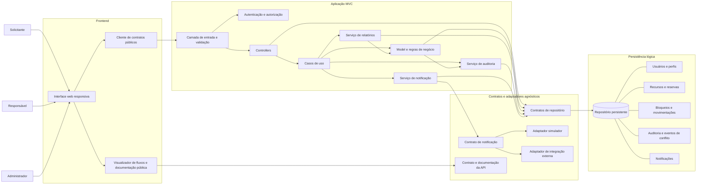

# Diagrama estático de componentes

## Escopo

Arquitetura lógica MVC agnóstica a linguagem, framework, protocolo, banco de dados e infraestrutura. O diagrama cobre os componentes necessários aos requisitos funcionais e não funcionais documentados.

## Responsabilidades e limites

- **Frontend:** apresenta os fluxos de consulta, gestão, reserva, aprovação, manutenção, movimentação e relatórios; informa estados e erros. A interface não substitui autorização e validação no servidor.
- **Camada de entrada:** recebe operações, valida sua estrutura e encaminha os pedidos aos Controllers.
- **Autenticação e autorização:** identifica a sessão e autoriza cada operação por perfil e contexto do recurso.
- **Controllers:** adaptam solicitações e respostas da interface aos casos de uso; não implementam regras de conflito ou acesso a dados.
- **Casos de uso:** coordenam os fluxos e as transações que envolvem domínio, persistência, auditoria e notificações.
- **Model e regras de negócio:** aplicam as regras de disponibilidade, sobreposição, concorrência, aprovação, manutenção, estoque e movimentação.
- **Repositórios:** isolam as operações de leitura e gravação do mecanismo físico de persistência.
- **Auditoria:** registra ator, operação, entidade afetada e data/hora de maneira associada à operação de negócio.
- **Relatórios:** consultam dados filtrados para utilização, carga horária e conflitos evitados.
- **Notificação:** usa o adaptador simulado ou externo; falhas são registradas e não desfazem reservas válidas.
- **Contrato/API e documentação:** descrevem os fluxos públicos e suas entradas, respostas, erros e requisitos de autorização.
- **Persistência lógica:** agrupa os dados descritos no diagrama de classes estático de entidades.

## Restrições arquiteturais

- Nenhum componente depende de fabricante, framework, linguagem, serviço de nuvem ou banco de dados específico.
- A validação de acesso, entradas e regras de negócio ocorre no servidor, mesmo que o frontend também apresente validações de usabilidade.
- Verificação de disponibilidade e gravação de uma alocação concorrente devem ocorrer com garantias transacionais.
- A gravação da operação de negócio e da respectiva auditoria deve manter consistência.
