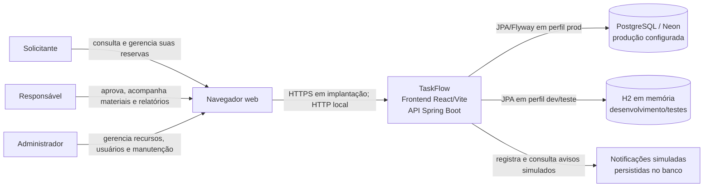

# Diagrama de contexto

O TaskFlow organiza recursos acadêmicos por meio de uma interface web e uma API. O diagrama representa as integrações existentes nesta versão, não serviços planejados.

## Limites e integrações

- Os três perfis acessam a mesma interface; autorização é aplicada no backend.
- O frontend encaminha chamadas `/api` ao serviço Spring Boot.
- O perfil local usa banco H2 em memória. O perfil de produção aceita PostgreSQL/Neon por configuração externa e não cria uma conta Administrador automaticamente.
- Notificações são simuladas e gravadas na aplicação. Não há integração ativa com e-mail, SMS ou outro serviço externo.
- Swagger/OpenAPI descreve a API; não é um ator nem uma dependência de runtime para os fluxos de negócio.
- Não há evidência de deploy de produção ou de HTTPS configurado nesta entrega local.
